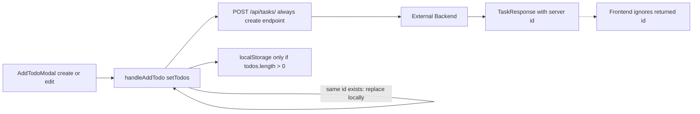
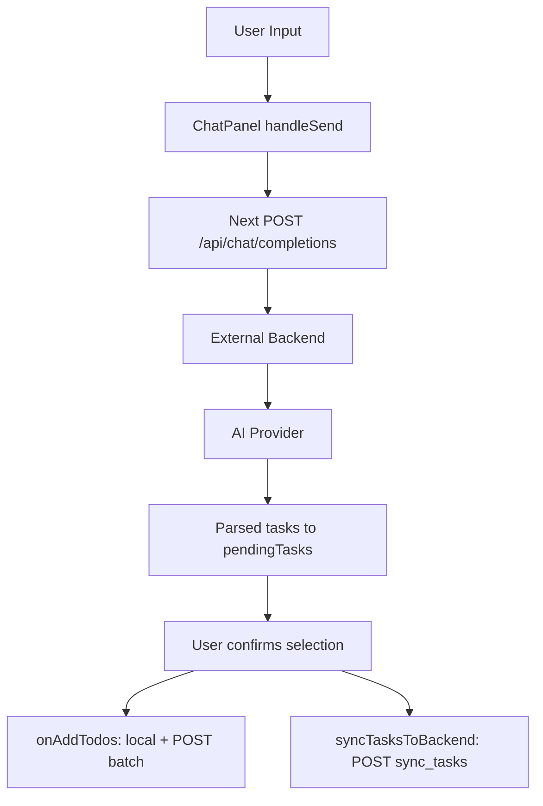
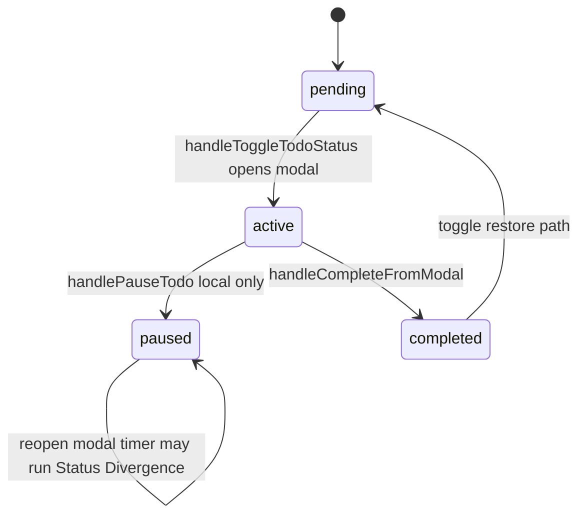
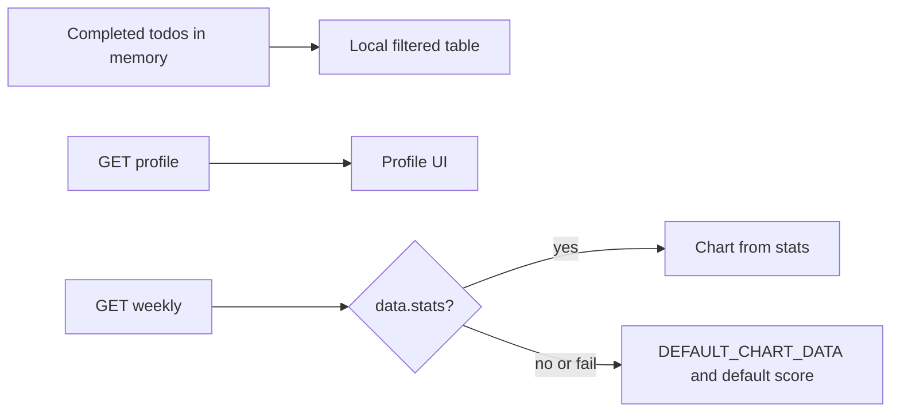

# FocusPal Current Architecture (As-Is)

**Status: As-Is Baseline frozen.** This document records the historical system state before Phase 0. Future fixes must not overwrite the historical findings here; subsequent changes must be recorded through Phase documents or a new version.

**Language:** English  
**Chinese counterpart:** [CURRENT_ARCHITECTURE_ZH.md](./CURRENT_ARCHITECTURE_ZH.md)  
**Baseline:** commit `b84ebe6` (`fix: TaskModal errorData TypeScript type for breakdown error handling`) and business code in this workspace  
**Nature:** **Static As-Is Architecture Baseline**. No target monorepo, refactor proposals, or Phase plans. Runtime evidence lives in `RUNTIME_BASELINE_EN.md`.  
**Evidence labels:** **Code Fact** / **Document Claim** / **Runtime Unknown** / **Inference**

**Environment note (does not mean the app cannot start):** High Environmental Risk: `NEXT_PUBLIC_API_URL` is not explicitly configured locally, so task, chat, and review interactions fall back to the remote Render backend. This does not block To-Be Architecture design, but it blocks safe and controlled local integration testing. Local build / dev / HTTP Route Smoke already passed (see Runtime Baseline).

---

## 1. System Scope

| Part | In this repo? | Evidence | Notes |
|------|---------------|----------|-------|
| Next.js frontend (App Router) | Yes | Code Fact | `app/`, `components/`, `lib/`, `package.json` (`next` ^14) |
| Next.js API routes (chat proxy, `/api/me`) | Yes | Code Fact | `app/api/chat/completions/route.ts`, `app/api/me/route.ts` |
| Clerk frontend integration | Yes | Code Fact | `@clerk/nextjs`, `ClerkLayoutWrapper`, `middleware.ts` |
| Backend business source (FastAPI, etc.) | **No** | Code Fact | No `apps/api` / Python backend implementation |
| External Render backend | Outside | Code Fact + Document Claim | Default URL `https://adhdcoach-backend.onrender.com` (`.env.example`, `API_URL` usages) |
| External AI Provider | Outside | Runtime Unknown / Inference | Frontend does not call the model directly; goes through backend; prior diagnosis saw ModelScope errors (not re-run here) |
| localStorage | Browser | Code Fact | todos backup, onboarding flags, review push settings |
| Database | No | Runtime Unknown | Persistence only inferable via external API |

**Not in this repo:** backend ORM/schema source, AI prompt source, real secret values (`.env.local` gitignored).

---

## 2. Repository Map

| Path | Role | Classification |
|------|------|----------------|
| `app/` | Next.js routes, pages, API routes | **Main product** |
| `components/` | UI and feature components | **Main product** |
| `lib/types.ts` | Todo / Message / Subtask types | **Main product** |
| `middleware.ts` | Clerk middleware | **Main product** |
| `public/` | Static assets | Main assets |
| `src/index.html`, `src/script.js`, `src/styles.css` | Vanilla demo | **Legacy / likely abandoned** (README still points here; product entry is Next) |
| `src/proxy.ts` | Alternate clerkMiddleware | **Likely leftover** (root `middleware.ts` is what runs) |
| `src/test/` | Vitest tests | Main tests (task-selection) |
| `adhd-coach-demo/` | Empty dir (historical) | Likely abandoned |
| `docs/` | Diagnosis, API notes, governance/architecture | Documentation (includes Document Claims) |
| `scripts/` | e.g. `gen-favicon.mjs` | Tooling |
| `.github/workflows/` | CI / automation | Engineering config |
| `package.json`, `next.config.js`, `tsconfig.json`, `tailwind.config.ts`, `vitest.config.ts` | Tooling config | Main |
| `.cursor/rules/`, `AGENTS.md` | Agent governance | Governance (not runtime product) |

---

## 3. Route Map

| Route | File | Public? | Middleware forces login? | How entered | Main job | Next navigations |
|-------|------|---------|--------------------------|-------------|----------|------------------|
| `/` | `app/page.tsx` | Yes | No (protect list empty) | Direct | `redirect("/try")` | `/try` |
| `/try` | `app/try/page.tsx` | Yes | No | Landing | Try CTA / login modal (OAuth, email, password) | `/onboarding`; login → SSO → `/auth-redirect` |
| `/onboarding` | `app/onboarding/page.tsx` | Yes | No | From try or auth-redirect | 3-step questionnaire; answers not posted to backend | Complete/skip → `/dashboard` |
| `/auth-redirect` | `app/auth-redirect/page.tsx` | Meaningful when signed in | No | After Clerk | Reads onboarding flags in localStorage | `/dashboard` or `/onboarding`; signed out → `/try` |
| `/dashboard` | `app/dashboard/page.tsx` | Guests allowed | No | After onboarding / auth / direct | Chat / Focus / Review shell | In-page tabs |
| `/trial` | `app/trial/page.tsx` | Yes | No | Direct | `replace("/dashboard")` | `/dashboard` |
| `/sign-in` | `app/sign-in/.../page.tsx` | Yes | No | Try modal | Clerk SignIn | `/auth-redirect` |
| `/sign-up` | `app/sign-up/.../page.tsx` | Yes | No | Sign-up | Clerk SignUp | `/auth-redirect` |
| `/sign-in-password` | `app/sign-in-password/page.tsx` | Yes | No | Try modal | Password sign-in UI | Clerk flow |
| `/sso-callback` | `app/sso-callback/page.tsx` | Yes | No | OAuth callback | `AuthenticateWithRedirectCallback` | Clerk completion URL |
| `/api/chat/completions` | `app/api/chat/completions/route.ts` | API | No | ChatPanel | Proxy to external backend | — |
| `/api/me` | `app/api/me/route.ts` | API | No | Onboarding | Returns Clerk `userId` or null | — |

**Code Fact:** `isProtectedRoute` in `middleware.ts` is an empty commented list, so `auth.protect()` does not force login on product pages.

---

## 4. Component Map

### DashboardPage (`app/dashboard/page.tsx`)

| Item | Content |
|------|---------|
| Props | None (page) |
| State | `todos`, `activeTab`, `isCelebrationActive`, `isLoading`, `selectedTodo`, `isModalOpen`, `activeSubtask`, `initialChatMessage`, `chatHistory` |
| Network | GET/POST/PUT/DELETE tasks; batch; conversations (**fully commented out**) |
| localStorage | Signed-in backup `adhd-coach-todos`; guests clear that key on enter |
| Children | ChatPanel, Dashboard, ReviewPanel, BottomNav, TaskModal |
| Mutates | Todo lifecycle, celebration, tabs, modal |
| Role | **Business state hub** + three-pane assembly |

### ChatPanel

| Item | Content |
|------|---------|
| Props | `onAddTodo`, `onAddTodos`, `todos`, `userId?`, `isSignedIn?`, `initialMessage?`, `onClearInitialMessage?`, `initialMessages?` |
| State | `input`, `messages`, `isThinking`, `chatStage`, `pendingTasks`, `selectedFile`, etc. |
| Network | POST `/api/chat/completions` (same-origin proxy); POST `${API_URL}/api/chat/sync_tasks` (optional JWT) |
| localStorage | None directly |
| Children | Chart.js doughnut (chart bubbles); inline task-selection UI |
| Mutates | Parent todos via callbacks; local messages / pendingTasks |
| Role | Chat UI, AI call, parse reply, confirm table; `processMessage` **defined but never called** (Code Fact) |

### Dashboard

| Item | Content |
|------|---------|
| Props | `todos`, delete/toggle/add/subtask callbacks |
| State | Add/edit modal open, `editingTodo`, `initialCategory` |
| Network | No direct fetch |
| Children | WeeklyCalendar, TimeBar, TodoList, AddTodoModal |
| Role | Focus pane assembly + add/edit modal |

### TodoList

| Item | Content |
|------|---------|
| Props | `todos`, delete/toggle/subtask/add/edit callbacks |
| State | `expandedTasks`, `collapsedGroups` |
| Network | None |
| Role | Group by category/status; start/delete/edit triggers |

### TaskModal

| Item | Content |
|------|---------|
| Props | `todo`, `isOpen`, `onClose`, `onComplete`, `onPause`, `onSubtaskToggle`, `onUpdateTodo`, `userId?` |
| State | Countdown, `isActive`, tips, breakdown loading/error, batch fields |
| Network | POST `${API_URL}/api/tasks/breakdown` (Bearer); default API fallback `http://localhost:8000` (**differs** from other files’ Render default — Code Fact) |
| Mutates | Complete/pause callbacks; `onUpdateTodo` for breakdown steps |
| Role | Focus execution UI + optional AI breakdown |

### ReviewPanel

| Item | Content |
|------|---------|
| Props | `todos?`, `userId?`, Clerk name/email, `onNavigateToChat?` |
| State | `userProfile`, `chartData`, `focusScore`, date range, push settings, etc. |
| Network | GET profile, GET weekly (`user_id` query, **no JWT observed**) |
| localStorage | `review-weekly-push` |
| Role | Review UI; on failure uses `DEFAULT_CHART_DATA` and default score (Code Fact) |

### WeeklyCalendar

| Item | Content |
|------|---------|
| Props | None |
| State | `selectedDate`, `currentWeekStart`, `weekDates` |
| Network | None |
| Role | Week UI; **does not** drive per-day task fetch on Dashboard (Code Fact) |

### Onboarding (`app/onboarding/page.tsx`)

| Item | Content |
|------|---------|
| State | `currentStep`, `selections` |
| Network | GET `/api/me` (for localStorage key) |
| localStorage | `onboarding_{userId}` or `onboarding_completed`; may clear todos |
| Role | Three-question UI; **answers are not POSTed to backend** (Code Fact) |

### ClerkLayoutWrapper

| Item | Content |
|------|---------|
| Props | `children` |
| Behavior | `/onboarding` **skips** `ClerkProvider`; other routes wrap Provider (redirect origins, afterSignIn/Up) |
| Role | Clerk assembly boundary |

---

## 5. Frontend State Ownership

| State | Owner | Mutators | Persistence | After refresh | Multiple truths? |
|-------|-------|----------|-------------|---------------|------------------|
| todos | DashboardPage `useState` | handleAdd/Delete/Toggle/Complete/Pause/Subtask; Chat callbacks; **edit reuses handleAddTodo** | Signed-in: API + LS backup (**write only if `todos.length > 0`**); guest: memory + LS cleared on enter | Signed-in: depends on GET; **LS fallback only on thrown fetch**; HTTP non-OK **does not necessarily** fallback | **Yes** (React / **stale LS backup** / backend id type mismatch) |
| task status | Same (`todo.status`) | Toggle / Complete / Pause; starting pending pauses other actives (**locally only**) | PUT **current task only**; pause **no API**; reopening paused **does not** set active | Contract field risks | **Yes** (Timer vs Todo.status; Client–Server Drift) |
| actualDuration | Written on complete | TaskModal: `Date.now() - startTime` (`startTime` set when **modal opens**) | Via complete PUT `actual_duration` | Depends on PUT | Semantics = **Modal Session Duration**, not pure timer run time (may include pre-start idle, paused time, reading/dwell) |
| Todo.id | Typed as `number`; runtime may hold backend string | GET map `task.id \|\| task._id` via `any`; delete/update signatures `number` | Server authoritative id not written back | Yes | **Identifier Authority** and **Type Contract** both inconsistent |
| active task / modal | `selectedTodo`, `isModalOpen`, `activeSubtask` | Toggle / SubtaskStart / Close | Memory only | No | In-page |
| subtasks | `todos[].subtasks` | Toggle; TaskModal breakdown via `onUpdateTodo` | steps on create POST; toggle **no backend call**; breakdown hits API | Partial | Yes |
| chat messages | ChatPanel `messages` | handleSend / welcome | None (conversations fetch commented out) | No | Single component |
| pending AI tasks | ChatPanel `pendingTasks` | AI response / user confirm | Not until confirm; then write paths | Not before confirm | May double-write into todos |
| onboarding completed flag | localStorage | onboarding / auth-redirect | localStorage | Same browser yes | Two keys: `onboarding_*` and `onboarding_completed` |
| onboarding answers | `selections` in page | Option clicks | **Not persisted to backend** (Code Fact) | No | — |
| review push settings | ReviewPanel | savePushSettings | localStorage | Yes | No |
| review chart/score | ReviewPanel state | weekly fetch or defaults | No solid aligned contract → defaults | Defaults look like real data | **Mock/fallback mixed with API** |
| user identity | Clerk | Sign-in/out | Clerk | Yes | FE identity ≠ backend authz |

---

## 6. API Call Map

| Call site | Method | URL | Next proxy? | Request | Expected response | JWT? | Passes user_id? | Success | Failure | Persist intent | Unknown |
|-----------|--------|-----|-------------|---------|-------------------|------|-----------------|---------|---------|----------------|---------|
| ChatPanel `callChatAPI` | POST | `/api/chat/completions` → backend same path | **Yes** | message, user_id, history, context | FE wants `success` + `data` | Bearer when signed in | Yes (incl. anonymous) | Text / pendingTasks | Error bubble; no success mock | Whether chats stored | Real success shape; Provider |
| `route.ts` proxy | POST | `${BACKEND}/api/chat/completions` | Is the proxy | Forwards body + Authorization | Pass-through JSON | Forwarded | Forwarded | Pass-through | 500 + message | — | Backend impl |
| ChatPanel `syncTasksToBackend` | POST | `${API_URL}/api/chat/sync_tasks` | No | user_id, date, tasks | json | Optional Bearer | Yes | Fire-and-forget | console | Yes | Dedup vs batch |
| Dashboard GET tasks | GET | `/api/tasks/?user_id=` | No | query user_id | `{ tasks: [...] }` | **No** | Yes | Map to Todo (id via `any`, typed as number) | **Only catch (throw) → LS**; `!response.ok` does not enter LS | Read | Field aliases; non-OK behavior |
| Dashboard POST task | POST | `/api/tasks/` | No | user_id, name, date… | (returned id unused) | **No** | Yes | Local updated; **edit of existing task also uses this POST** | console | Write intent; **ID gap**; whether edit duplicates rows | Response body; duplicates (Runtime Unknown) |
| Dashboard POST batch | POST | `/api/tasks/batch` | No | `{ tasks: [...] }` | Return unused | **No** | Per item | Local append | console | Yes | Relation to sync |
| Dashboard PUT status | PUT | `/api/tasks/{id}` | No | status, started_at / completed_at… | Unvalidated | **No** | No (path id) | Local first | console | Write intent | Field names; id authority |
| Dashboard DELETE | DELETE | `/api/tasks/{id}` | No | — | — | **No** | No | Local first | console | Delete intent | id |
| conversations (commented) | GET | `/api/chat/conversations/{id}` | No | — | message array | — | Path | Disabled | — | — | Whether written |
| TaskModal breakdown | POST | `/api/tasks/breakdown` | No | task_id, task_name, user_id, planned_duration | subtasks… | **Yes** (Bearer) | Yes | onUpdateTodo | Error text | Backend updates steps (Inference) | Auth rules |
| Review profile | GET | `/api/users/profile?user_id=` | No | user_id | name, user_type, peak_hours… | **No** | Yes | setProfile | Clerk/defaults | Read | camel vs snake |
| Review weekly | GET | `/api/reports/weekly?user_id=` | No | user_id | FE wants `data.stats.*` | **No** | Yes | Set chart | **DEFAULT_CHART + default score** | Read | Real contract shape |
| Onboarding `/api/me` | GET | `/api/me` | Next-local | — | `{ userId }` | Clerk cookie (server `auth`) | — | Write LS key | Fallback LS | No business payload | — |

**This round did not call production write APIs** (diagnosis ban).

---

## 7. Data Flow

### 7.1 Manual create / edit task



**Code Fact:**

- Local ids often `Date.now()` / `Date.now()+random`; successful POST **does not write back** server id.
- **Edit** existing task: replace locally by id; backend still calls **POST create** (not PUT update). Whether DB gets duplicate rows: **Runtime Unknown**.
- localStorage: written **only** when `user && todos.length > 0`; deleting the last task **does not** overwrite with `[]` → **stale backup** risk; thrown network errors may restore old list. HTTP non-OK without throw **does not necessarily** fallback.

### 7.2 AI task generation



**Code Fact:** Confirm triggers **both** `batch` and `sync_tasks` → double-write risk.  
**Runtime Unknown:** Whether backend deduplicates.

### 7.3 Focus execution



- Start (pending→active): current task `active` + optional PUT; **other previously active tasks are set to paused only in local state — no PUT for them** → **Client–Server State Drift** (backend may still have multiple actives).
- Pause (active→paused): local status + remainingTime; **no** PUT.
- Reopen paused: opens TaskModal and may start the **internal timer**; **parent `Todo.status` stays `paused`**; **no** backend resume → **State Divergence** (Timer state vs Todo business state; a paused task can run a timer while status remains paused).
- Complete: `actualDuration` = `Date.now() - startTime`, with `startTime` set on **modal open**, **not** accumulated timer run time. May include: idle before start, paused periods, reading/dwell. Closer to **Modal Session Duration** than **Actual Focus Duration**.
- **Inference:** If backend expects `start_time`/`end_time`, current PUT fields may be ignored.

### 7.4 Review



**Code Fact:** Table mainly from frontend `todos`; doughnut uses defaults 30/25/20/25 and ~85 score when contract mismatches or request fails.

---

## 8. Authentication and Authorization

| Mechanism | As-Is |
|-----------|-------|
| ClerkProvider | `ClerkLayoutWrapper`; skipped on onboarding |
| useUser / useAuth | Dashboard, Chat, TaskModal, try, auth-redirect, etc. |
| JWT | `getToken()` for chat, breakdown, sync |
| user_id only | tasks CRUD GET/POST/PUT/DELETE, profile, weekly |
| middleware | Broad matcher; **empty protect list** → no forced login |
| `/api/me` | Server `auth()` reads Clerk session |
| FE auth vs BE authz | Frontend knows who is signed in; most task APIs **do not send JWT** (Code Fact). Whether backend verifies is Runtime Unknown; prior diagnosis: some Tasks accept `user_id` without valid JWT (Document Claim / prior diagnosis; write APIs not re-probed this round) |

---

## 9. Current Task State Machine

```text
pending
  --[play]--> active  (PUT current only; other actives → paused locally only)
active
  --[handlePauseTodo]--> paused     (local only; no API)
  --[complete]--> completed         (+ optional PUT; actualDuration = modal session)
paused
  --[reopen modal]--> paused        (Todo.status unchanged; timer may run — State Divergence)
  --[no business transition to active on reopen]-->
completed
  --[toggle restore]--> pending     (+ optional PUT)
```

| Transition | Trigger | Frontend | Backend | Notes |
|------------|---------|----------|---------|-------|
| pending→active | Toggle pending | current→active; other actives→paused | **PUT current only** | Others paused: **Client–Server Drift** |
| active→paused | Modal pause | status+remainingTime | **None** | |
| paused + timer | Reopen modal and start timer | **status stays paused**; modal timer only | **None** | **State Divergence** |
| → completed | Modal complete | actualDuration = wall clock since modal open | PUT completed_* | Modal Session Duration |
| → pending | List restore | Yes | PUT pending | |
| Edit task | AddTodoModal→handleAddTodo | Local replace by id | **Still POST create** | DB duplicate: Runtime Unknown |

Ambiguity: subtasks open a temporary Todo in the modal; complete may mark subtask completed rather than parent state machine.

---

## 10. Current Dependency Direction (actual)

```text
Page (dashboard)
  ├─ owns todos / modal / tabs
  ├─ fetch directly to Render URL (no unified API Client)
  ├─ ChatPanel ──fetch──> Next Proxy ──> Backend
  │            └─fetch──> Backend sync_tasks
  ├─ Dashboard ──> TodoList / AddTodoModal / WeeklyCalendar / TimeBar
  ├─ TaskModal ──fetch──> Backend breakdown (different default Base URL)
  └─ ReviewPanel ──fetch──> Backend profile/weekly + localStorage + DEFAULT mock
```

Actual traits (Code Fact):

- UI/pages concatenate API URLs and `fetch`
- Page owns core business state
- Components map backend fields inline
- localStorage used for todos / onboarding / review
- Mock/defaults mixed with real data in Review
- Externals: Clerk, Render backend, AI Provider (behind backend)

---

## 11. Runtime and Deployment

| Item | As-Is |
|------|-------|
| Dev start | `npm run dev` → `next dev` (Code Fact) |
| Build | `npm run build` / `start` |
| Test | `npm test` → vitest (`src/test/task-selection.test.ts`) |
| Frontend deploy | Document Claim: Vercel hosts appear in Clerk `allowedRedirectOrigins`; whether production is healthy is Runtime Unknown |
| Backend URL | `NEXT_PUBLIC_API_URL` or default Render |
| Env vars | `.env.example`: Clerk keys + API URL; secrets in `.env.local` (gitignored) |
| CI | `.github/workflows/` present; whether typecheck/test are enforced depends on each YAML |
| Production health | Not re-verified this round; Runtime Unknown |

---

## 12. Architecture Risks

| ID | Risk | Evidence | Impact | Severity | Module | Files | Blocks migration? |
|----|------|----------|--------|----------|--------|-------|-------------------|
| R1 | Task APIs mostly rely on user_id without uniform JWT on FE | fetches lack Authorization | Weak authz model | Critical | tasks | `app/dashboard/page.tsx` | Yes (security baseline) |
| R2 | AI confirm double-write | batch + sync_tasks | Duplicate data | Critical | chat/tasks | ChatPanel + dashboard | Yes |
| R3 | Create does not write back server ID | POST ignores response id | Wrong update/delete targets | Critical | tasks | dashboard page | Yes |
| R4 | Inconsistent default API base URL | TaskModal localhost vs others Render | Split env behavior | High | focus | TaskModal.tsx | No but footgun |
| R5 | Review defaults fake success | DEFAULT_CHART + score | Misleading product signal | High | review | ReviewPanel.tsx | Know before Phase 5 |
| R6 | Pause not persisted; reopen paused diverges timer vs Todo.status | handlePauseTodo no fetch; reopen does not change status | Pause lost on refresh; list shows paused while timer runs | High | focus | dashboard / TaskModal | Phase 3 |
| R6b | Other actives paused only locally on start | setTodos updates others; PUT only current | Backend may keep multiple actives | High | focus/tasks | dashboard page | Phase 3 |
| R6c | actualDuration = Modal Session Duration | startTime on modal open | Focus time overstated | Medium | focus | TaskModal | No |
| R6d | localStorage stale backup | write only if length>0; empty delete does not overwrite | Deleted tasks may resurrect on throw | High | tasks | dashboard page | Yes |
| R6e | Todo.id number vs backend string; edit still POST create | types + map any + handleAddTodo | Type lie; possible duplicate rows | High | tasks | lib/types + dashboard | Yes |
| R7 | Likely contract field mismatch | started_at vs docs/OpenAPI; weekly stats shape | Silent failure | High | tasks/review | multiple | Until contracts align |
| R8 | No unified API Client; huge page state | scattered fetch + dashboard hub | Hard to test/migrate | Medium | global | dashboard/Chat/Review | Costly, not hard-block |
| R9 | middleware does not protect product routes | empty protect list | UI-only habit | Medium | auth | middleware.ts | Phase 1 |
| R10 | Vanilla `src/` alongside Next | dual entry docs | Confusion | Low | repo | src/, README | No |

---

## 13. Unknowns

| Unknown | Needs |
|---------|-------|
| Backend source, prompts, DB schema, JWT verification | Backend repo / original developer |
| Whether chat success wraps `success/data` | Local integration / capture (no production write experiments) |
| Authoritative weekly/profile field names | OpenAPI + one real GET (read-only) |
| AI Provider and key health | Deploy console / backend config |
| Whether production Vercel/Render is healthy | Hosting dashboards |
| Whether conversations were ever written | Backend + enabling FE fetch |
| Whether edit-via-POST duplicates rows | Controlled test DB / read-only DB inspect |
| Clerk production domains completeness | Clerk Dashboard |

---

## Document boundary

- **This document = As-Is Current Architecture only.**
- To-Be target layout lives in `PROJECT_STRUCTURE_*` (do not treat as “already implemented”).
---
