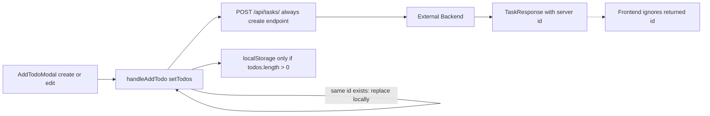
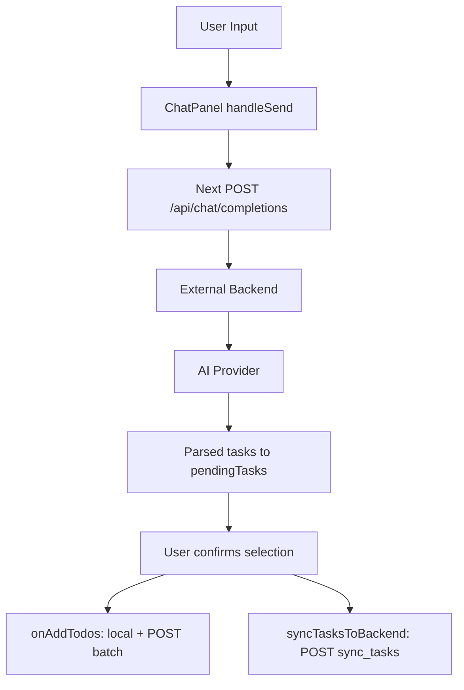
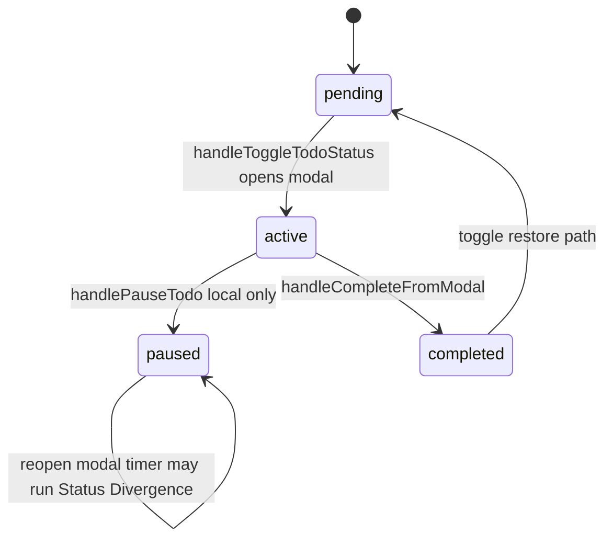
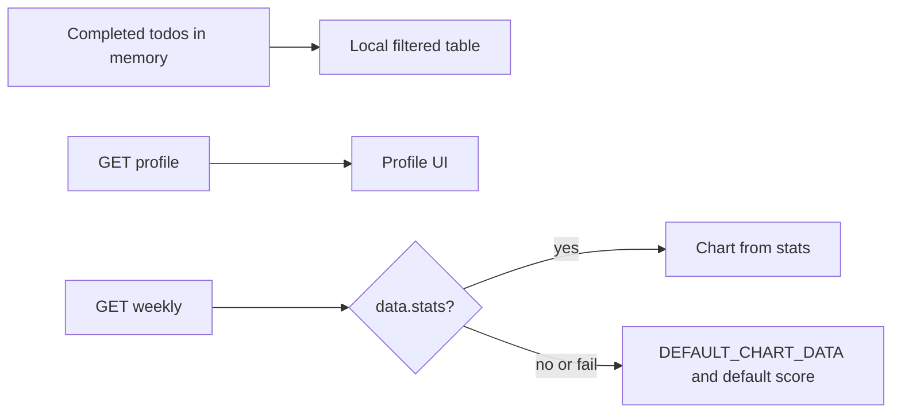

# FocusPal 当前架构（As-Is）

**状态：As-Is Baseline 已冻结。** 本文件只记录 Phase 0 之前的历史系统事实。后续修复不得覆盖这里的历史结论；系统发生变化后，应通过 Phase 文档或新的版本记录变化。

**文档语言：** 中文  
**对应英文：** [CURRENT_ARCHITECTURE_EN.md](./CURRENT_ARCHITECTURE_EN.md)  
**基线：** commit `b84ebe6`（`fix: TaskModal errorData TypeScript type for breakdown error handling`）及同工作区业务代码  
**性质：** **Static As-Is Architecture Baseline**（静态现状基线）。不含目标 Monorepo、推荐重构或 Phase 迁移方案。运行证据见 `RUNTIME_BASELINE_ZH.md`（Runtime Baseline Verification）。  
**证据标注：** **Code Fact** / **Document Claim** / **Runtime Unknown** / **Inference**

**环境备注（不表示无法启动）：** High Environmental Risk：本地环境未显式设置 `NEXT_PUBLIC_API_URL`，因此进行任务、聊天、复盘等交互时会回退并连接远程 Render 后端。这不阻断 To-Be Architecture 设计，但会阻断安全、可控的本地集成测试。本地 build / dev / HTTP Route Smoke 已通过（见 Runtime Baseline）。

---

## 1. System Scope

| 组成部分 | 是否在本仓库 | 证据类型 | 说明 |
|----------|--------------|----------|------|
| Next.js 前端（App Router） | 是 | Code Fact | `app/`、`components/`、`lib/`、`package.json`（`next` ^14） |
| Next.js API Route（聊天代理、`/api/me`） | 是 | Code Fact | `app/api/chat/completions/route.ts`、`app/api/me/route.ts` |
| Clerk 前端接入 | 是 | Code Fact | `@clerk/nextjs`、`ClerkLayoutWrapper`、`middleware.ts` |
| 后端业务源码（FastAPI 等） | **否** | Code Fact | 仓库内无 `apps/api` / Python 后端实现 |
| 外部 Render 后端 | 仓库外 | Code Fact + Document Claim | 默认 URL `https://adhdcoach-backend.onrender.com`（`.env.example`、多处 `API_URL`） |
| 外部 AI Provider | 仓库外 | Runtime Unknown / Inference | 前端不直连模型；经由后端；历史诊断曾见 ModelScope 错误（不属本文件运行时复测） |
| localStorage | 是（浏览器） | Code Fact | todos 备份、onboarding、review 推送设置 |
| 数据库 | 否 | Runtime Unknown | 仅能通过外部 API 推断存在持久化 |

**本仓库不包含：** 后端 ORM/表结构源码、AI Prompt 源码、生产密钥真值（`.env.local` 被 gitignore）。

---

## 2. Repository Map

| 路径 | 角色 | 判定 |
|------|------|------|
| `app/` | Next.js 路由、页面、API Routes | **主版本** |
| `components/` | UI 与业务组件 | **主版本** |
| `lib/types.ts` | Todo / Message / Subtask 类型 | **主版本** |
| `middleware.ts` | Clerk middleware | **主版本** |
| `public/` | 静态资源（logo、demo 图） | 主版本资源 |
| `src/index.html`、`src/script.js`、`src/styles.css` | Vanilla Demo | **历史 / 疑似废弃**（README 仍指向，但产品入口是 Next） |
| `src/proxy.ts` | 另一份 clerkMiddleware | **疑似废弃残留**（根目录 `middleware.ts` 生效） |
| `src/test/` | Vitest 测试 | 主版本测试（任务选择相关） |
| `adhd-coach-demo/` | 空目录（历史） | 疑似废弃 |
| `docs/` | 诊断、对接说明、治理/架构文档 | 文档目录；含 Document Claim |
| `scripts/` | 如 `gen-favicon.mjs` | 工具脚本 |
| `.github/workflows/` | CI / 自动合并等 | 工程配置 |
| `package.json`、`next.config.js`、`tsconfig.json`、`tailwind.config.ts`、`vitest.config.ts` | 工程配置 | 主版本 |
| `.cursor/rules/`、`AGENTS.md` | Agent 治理 | 治理层（非运行时业务） |

---

## 3. Route Map

| 路由 | 文件 | 公开？ | middleware 强制登录？ | 进入方式 | 主要功能 | 后续跳转 |
|------|------|--------|----------------------|----------|----------|----------|
| `/` | `app/page.tsx` | 是 | 否（保护列表为空） | 直接访问 | `redirect("/try")` | `/try` |
| `/try` | `app/try/page.tsx` | 是 | 否 | 落地 | 开始尝试 / 登录弹窗（OAuth、邮件、密码） | `/onboarding`；登录 → SSO → `/auth-redirect` |
| `/onboarding` | `app/onboarding/page.tsx` | 是 | 否 | 从 try 或 auth-redirect | 3 步问卷；答案不入后端 | 完成/跳过 → `/dashboard` |
| `/auth-redirect` | `app/auth-redirect/page.tsx` | 需已登录才有意义 | 否 | Clerk 登录后 | 读 localStorage onboarding | `/dashboard` 或 `/onboarding`；未登录 → `/try` |
| `/dashboard` | `app/dashboard/page.tsx` | 游客可进 | 否 | onboarding / auth-redirect / 直接 | Chat / Focus / Review 主壳 | 页内 tab |
| `/trial` | `app/trial/page.tsx` | 是 | 否 | 直接 | `replace("/dashboard")` | `/dashboard` |
| `/sign-in` | `app/sign-in/.../page.tsx` | 是 | 否 | try 弹窗 | Clerk SignIn | `/auth-redirect` |
| `/sign-up` | `app/sign-up/.../page.tsx` | 是 | 否 | 注册 | Clerk SignUp | `/auth-redirect` |
| `/sign-in-password` | `app/sign-in-password/page.tsx` | 是 | 否 | try 弹窗 | 密码登录 UI | （Clerk 流程） |
| `/sso-callback` | `app/sso-callback/page.tsx` | 是 | 否 | OAuth 回调 | `AuthenticateWithRedirectCallback` | Clerk 完成 URL |
| `/api/chat/completions` | `app/api/chat/completions/route.ts` | API | 否 | ChatPanel | 代理到外部后端 | — |
| `/api/me` | `app/api/me/route.ts` | API | 否 | onboarding | 返回 Clerk `userId` 或 null | — |

**Code Fact：** `middleware.ts` 中 `isProtectedRoute` 匹配列表被注释为空，故 `auth.protect()` 实际上不对业务页强制登录。

---

## 4. Component Map

### DashboardPage（`app/dashboard/page.tsx`）

| 项 | 内容 |
|----|------|
| Props | 无（页面） |
| State | `todos`、`activeTab`、`isCelebrationActive`、`isLoading`、`selectedTodo`、`isModalOpen`、`activeSubtask`、`initialChatMessage`、`chatHistory` |
| 网络 | GET/POST/PUT/DELETE tasks；batch；conversations（**整段注释，未启用**） |
| localStorage | 登录用户备份 `adhd-coach-todos`；游客清除该 key |
| 子组件 | ChatPanel、Dashboard、ReviewPanel、BottomNav、TaskModal |
| 修改业务状态 | todos 生命周期、庆祝、tab、模态 |
| 职责 | **业务状态中枢** + 三栏装配 |

### ChatPanel

| 项 | 内容 |
|----|------|
| Props | `onAddTodo`、`onAddTodos`、`todos`、`userId?`、`isSignedIn?`、`initialMessage?`、`onClearInitialMessage?`、`initialMessages?` |
| State | `input`、`messages`、`isThinking`、`chatStage`、`pendingTasks`、`selectedFile` 等 |
| 网络 | POST `/api/chat/completions`（同源代理）；POST `${API_URL}/api/chat/sync_tasks`（可带 JWT） |
| localStorage | 无直接读写 |
| 子组件 | Chart.js Doughnut（图表气泡）；内联任务选择 UI |
| 修改业务状态 | 经回调改父级 todos；本地 messages / pendingTasks |
| 职责 | 聊天 UI、调 AI、解析回复、任务确认表；`processMessage` **已定义但未被调用**（Code Fact） |

### Dashboard

| 项 | 内容 |
|----|------|
| Props | `todos`、删除/切换状态/添加/子任务回调 |
| State | 添加/编辑弹窗开关、`editingTodo`、`initialCategory` |
| 网络 | 无直接 fetch |
| 子组件 | WeeklyCalendar、TimeBar、TodoList、AddTodoModal |
| 职责 | Focus 区装配与添加/编辑弹窗 |

### TodoList

| 项 | 内容 |
|----|------|
| Props | `todos`、删除/切换/子任务/添加/编辑回调 |
| State | `expandedTasks`、`collapsedGroups` |
| 网络 | 无 |
| 职责 | 按 category/status 分组展示；触发开始/删除/编辑 |

### TaskModal

| 项 | 内容 |
|----|------|
| Props | `todo`、`isOpen`、`onClose`、`onComplete`、`onPause`、`onSubtaskToggle`、`onUpdateTodo`、`userId?` |
| State | 倒计时、`isActive`、tips、拆解 loading/error、批次相关 |
| 网络 | POST `${API_URL}/api/tasks/breakdown`（Bearer token）；默认 API 回退为 `http://localhost:8000`（与其它文件默认 Render **不一致**，Code Fact） |
| 修改业务状态 | 完成/暂停回调；`onUpdateTodo` 写入拆解子任务 |
| 职责 | 专注执行 UI + 可选 AI 拆解 |

### ReviewPanel

| 项 | 内容 |
|----|------|
| Props | `todos?`、`userId?`、Clerk 姓名邮箱、`onNavigateToChat?` |
| State | `userProfile`、`chartData`、`focusScore`、日期范围、推送设置等 |
| 网络 | GET profile、GET weekly（均 `user_id` query，**未见 JWT**） |
| localStorage | `review-weekly-push` |
| 职责 | 复盘 UI；失败时用 `DEFAULT_CHART_DATA` 与默认分（Code Fact） |

### WeeklyCalendar

| 项 | 内容 |
|----|------|
| Props | 无 |
| State | `selectedDate`、`currentWeekStart`、`weekDates` |
| 网络 | 无 |
| 职责 | 周历 UI；**不驱动** Dashboard 按日拉任务（Code Fact） |

### Onboarding（`app/onboarding/page.tsx`）

| 项 | 内容 |
|----|------|
| State | `currentStep`、`selections` |
| 网络 | GET `/api/me`（取 userId 写 localStorage key） |
| localStorage | `onboarding_{userId}` 或 `onboarding_completed`；可清 todos |
| 职责 | 三问 UI；**答案本身不 POST 后端**（Code Fact） |

### ClerkLayoutWrapper

| 项 | 内容 |
|----|------|
| Props | `children` |
| 行为 | `/onboarding` **不**包 `ClerkProvider`；其它页包 Provider（redirect origins、afterSignIn/Up） |
| 职责 | Clerk 装配边界 |

---

## 5. Frontend State Ownership

| 状态 | 当前所有者 | 修改位置 | 持久化 | 刷新后 | 多真相源？ |
|------|------------|----------|--------|--------|------------|
| todos | DashboardPage `useState` | handleAdd/Delete/Toggle/Complete/Pause/Subtask；Chat 回调；**编辑复用 handleAddTodo** | 登录：API + localStorage 备份（**仅 `todos.length > 0` 时写入**）；游客：内存且进页清 LS | 登录：依赖 GET；**仅 fetch throw 时** LS fallback；HTTP non-OK **不一定** fallback | **是**（React / **陈旧 LS 备份** / 后端 id 类型可能不一致） |
| task status | 同上（todo.status） | Toggle / Complete / Pause；开始 pending 时其它 active→paused（**仅本地**） | PUT **仅当前任务**；pause **无 API**；重开 paused **不**改回 active | 字段映射风险见契约节 | **是**（Timer vs Todo.status；Client–Server Drift） |
| actualDuration | 完成时写入 todo | TaskModal：`Date.now() - startTime`（**打开模态时**设 startTime） | 随完成 PUT `actual_duration` | 依赖上述 PUT | 语义为 **Modal Session Duration**，非纯计时器运行时长（可含打开后未开跑、暂停停留、阅读时间） |
| Todo.id | 类型声明 `number`；运行时常混入后端 string | GET map `task.id \|\| task._id`（`any`）；delete/update 签名 `number` | 服务端权威 id 未回写 | 是 | **Identifier Authority** 与 **Type Contract** 均不一致 |
| active task / modal | `selectedTodo`、`isModalOpen`、`activeSubtask` | Toggle / SubtaskStart / Close | 否（仅内存） | 否 | 单页内 |
| subtasks | todos[].subtasks | Toggle；TaskModal breakdown `onUpdateTodo` | 创建时 steps 可 POST；toggle **无后端调用**；breakdown 依赖后端 | 部分 | 是 |
| chat messages | ChatPanel `messages` | handleSend / 初始欢迎语 | 无（conversations 拉取注释掉） | 否 | 单组件 |
| pending AI tasks | ChatPanel `pendingTasks` | AI 返回 / 用户勾选确认 | 确认前否；确认后走写入 | 确认前否 | 与 todos 衔接时可能双写 |
| onboarding 完成标记 | localStorage | onboarding / auth-redirect 读 | localStorage | 同浏览器是 | key 两种：`onboarding_*` 与 `onboarding_completed` |
| onboarding 答案内容 | 组件内 `selections` | 选择选项 | **不持久化到后端**（Code Fact） | 否 | — |
| review 推送设置 | ReviewPanel | savePushSettings | localStorage | 是 | 否 |
| review 图表/分数 | ReviewPanel state | fetch weekly 或默认常量 | 无可靠服务端契约对齐时用默认 | 默认像「有数据」 | **Mock/Fallback 与真实 API 混合** |
| user identity | Clerk | 登录/登出 | Clerk | 是 | 前端身份；后端授权另论 |

---

## 6. API Call Map

| 调用位置 | Method | URL | Next Proxy？ | Request 要点 | 期望响应 | JWT？ | 传 user_id？ | 成功 | 失败 | 持久化意图 | 无法确认 |
|----------|--------|-----|--------------|--------------|----------|-------|--------------|------|------|------------|----------|
| ChatPanel `callChatAPI` | POST | `/api/chat/completions` → 后端同路径 | **是** | message, user_id, history, context | 前端要 `success` + `data` | 登录时 Bearer | 是（含 anonymous） | 展示文本 / pendingTasks | 错误气泡；无 Mock 成功 | 对话是否落库 | 成功体真实形状；Provider |
| route.ts 代理 | POST | `${BACKEND}/api/chat/completions` | 自身 | 透传 body + Authorization | 透传 JSON | 透传 | 透传 | 原样返回 | 500 + message | — | 后端实现 |
| ChatPanel `syncTasksToBackend` | POST | `${API_URL}/api/chat/sync_tasks` | 否 | user_id, date, tasks | json | 可选 Bearer | 是 | fire-and-forget | console | 是 | 与 batch 是否重复 |
| Dashboard GET tasks | GET | `/api/tasks/?user_id=` | 否 | query user_id | `{ tasks: [...] }` | **否** | 是 | map 到 Todo（id 经 `any`，类型声明为 number） | **仅 catch（抛错）→ LS**；`!response.ok` 不进 LS | 读 | 字段别名；non-OK 行为 |
| Dashboard POST task | POST | `/api/tasks/` | 否 | user_id, name, date… | （未使用返回 id） | **否** | 是 | 本地已更新；**编辑已有任务也走此 POST** | console | 意图写；**ID 缺口**；编辑是否产生重复行 | 响应体；重复记录（Runtime Unknown） |
| Dashboard POST batch | POST | `/api/tasks/batch` | 否 | `{ tasks: [...] }` | 未用返回 | **否** | 每项 user_id | 本地已加 | console | 是 | 与 sync 关系 |
| Dashboard PUT status | PUT | `/api/tasks/{id}` | 否 | status, started_at / completed_at… | 未校验 | **否** | 否（靠路径 id） | 本地先改 | console | 意图写 | 字段名；id 是否服务端 |
| Dashboard DELETE | DELETE | `/api/tasks/{id}` | 否 | — | — | **否** | 否 | 本地先删 | console | 意图删 | id |
| conversations（注释） | GET | `/api/chat/conversations/{id}` | 否 | — | 消息数组 | — | 路径 | 未启用 | — | — | 是否写入 |
| TaskModal breakdown | POST | `/api/tasks/breakdown` | 否 | task_id, task_name, user_id, planned_duration | subtasks… | **是**（Bearer） | 是 | onUpdateTodo | 错误文案 | 后端更新 steps（Inference） | 鉴权规则 |
| Review profile | GET | `/api/users/profile?user_id=` | 否 | user_id | name, user_type, peak_hours… | **否** | 是 | setProfile | Clerk/默认 | 读 | 字段 camel/snake |
| Review weekly | GET | `/api/reports/weekly?user_id=` | 否 | user_id | 前端要 `data.stats.*` | **否** | 是 | 设图表 | **DEFAULT_CHART + 默认分** | 读 | 真实契约形状 |
| Onboarding `/api/me` | GET | `/api/me` | Next 内 | — | `{ userId }` | Clerk cookie（服务端 auth） | — | 写 LS key | fallback LS | 否业务数据 | — |

**本轮未调用线上写接口验证**（遵守诊断禁令）。

---

## 7. Data Flow

### 7.1 手动创建 / 编辑任务



**Code Fact：**

- 本地 id 常用 `Date.now()` / `Date.now()+random`；POST 成功后**不回写**服务端 id。
- **编辑**已有任务：本地按 id **替换**；后端仍调用 **POST create**（非 PUT update）。是否在库中产生重复记录：**Runtime Unknown**。
- localStorage：**仅** `user && todos.length > 0` 时写入；删光任务**不会**用 `[]` 覆盖旧备份 → **stale backup** 风险；网络 **抛错** 时可能恢复旧列表。HTTP non-OK 且未 throw 时**不一定** fallback。

### 7.2 AI 生成任务



**Code Fact：** 确认路径同时触发 **batch** 与 **sync_tasks** → 双写风险。  
**Runtime Unknown：** 后端是否幂等去重。

### 7.3 Focus Execution



- Start（pending→active）：本地当前任务 `active` + 可选 PUT；**其它原本 active 的任务仅在本地改为 paused，不对它们发 PUT** → **Client–Server State Drift**（后端可能仍保留多个 active）。
- Pause（active→paused）：本地 status + remainingTime；**无** PUT。
- 重开 paused：只打开 TaskModal 并可启动**内部 timer**；**父级 `Todo.status` 保持 `paused`**，**无**后端恢复请求 → **State Divergence**（Timer state vs Todo business state；paused 任务可在 status 仍为 paused 时跑计时器）。
- Complete：`actualDuration` = `Date.now() - startTime`，而 `startTime` 在**模态打开时**设置，**不是**计时器累计运行时长。可包含：开跑前停留、paused 期间、阅读/停留时间。更接近 **Modal Session Duration**，而非 **Actual Focus Duration**。
- **Inference：** 若后端字段为 `start_time`/`end_time`，当前 PUT 可能无效。

### 7.4 Review



**Code Fact：** 表格主要来自前端 `todos`；环图在契约不匹配或失败时用默认 30/25/20/25 与分数约 85。

---

## 8. Authentication and Authorization

| 机制 | As-Is |
|------|-------|
| ClerkProvider | `ClerkLayoutWrapper`；onboarding 除外 |
| useUser / useAuth | Dashboard、Chat、TaskModal、try、auth-redirect 等 |
| JWT | `getToken()` 用于聊天与 breakdown、sync |
| 仅 user_id | tasks CRUD GET/POST/PUT/DELETE、profile、weekly |
| middleware | matcher 广；**保护路由列表为空** → 不强制登录 |
| `/api/me` | 服务端 `auth()` 读 Clerk session |
| 前端认证 vs 后端授权 | 前端知道「谁登录」；多数任务 API **不在请求中证明** JWT（Code Fact）。后端是否校验为 Runtime Unknown；历史诊断表述：部分 Tasks 在无有效 JWT 时仍接受 `user_id`（Document Claim / 既有诊断，本轮未复测写接口） |

---

## 9. Current Task State Machine

```text
pending
  --[play]--> active  (PUT current only; other actives → paused locally only)
active
  --[handlePauseTodo]--> paused     (local only; no API)
  --[complete]--> completed         (+ optional PUT; actualDuration = modal session)
paused
  --[reopen modal]--> paused        (Todo.status unchanged; timer may run — State Divergence)
  --[no business transition to active on reopen]-->
completed
  --[toggle restore]--> pending     (+ optional PUT)
```

| 转换 | 触发 | 前端 | 后端 | 备注 |
|------|------|------|------|------|
| pending→active | Toggle pending | 当前→active；其它 active→paused | **仅 PUT 当前任务** | 其它 paused：**Client–Server Drift** |
| active→paused | Modal pause | status+remainingTime | **无** | |
| paused + timer | 重开模态并点开始计时 | **status 仍 paused**；仅 modal timer | **无** | **State Divergence** |
| → completed | Modal complete | actualDuration=打开模态起墙钟秒数 | PUT completed_* | Modal Session Duration |
| → pending | 列表恢复 | 是 | PUT pending | |
| 编辑任务 | AddTodoModal→handleAddTodo | 本地按 id 替换 | **仍 POST create** | 库是否重复：Runtime Unknown |

模糊点：子任务用临时 Todo 打开模态，完成时可能写子任务 completed 而非父任务状态机。

---

## 10. Current Dependency Direction（实际）

```text
Page (dashboard)
  ├─ owns todos / modal / tabs
  ├─ fetch 直连 Render URL（无统一 API Client）
  ├─ ChatPanel ──fetch──> Next Proxy ──> Backend
  │            └─fetch──> Backend sync_tasks
  ├─ Dashboard ──> TodoList / AddTodoModal / WeeklyCalendar / TimeBar
  ├─ TaskModal ──fetch──> Backend breakdown（另一默认 Base URL）
  └─ ReviewPanel ──fetch──> Backend profile/weekly + localStorage + DEFAULT mock
```

实际特征（Code Fact）：

- UI/页面直接拼接 API URL 并 fetch
- 页面持有核心业务状态
- 组件内 map 后端字段（tasks、profile、weekly）
- localStorage 参与 todos / onboarding / review
- Mock/默认与真实数据在 Review 混合
- 外部：Clerk、Render 后端、（后端后的）AI Provider

---

## 11. Runtime and Deployment

| 项 | As-Is |
|----|------|
| 开发启动 | `npm run dev` → `next dev`（Code Fact） |
| 构建 | `npm run build` / `start` |
| 测试 | `npm test` → vitest（存在 `src/test/task-selection.test.ts`） |
| 前端部署 | Document Claim：Vercel 域名出现在 Clerk `allowedRedirectOrigins`（focuspal-ten / focuspal.vercel.app）；生产是否在跑为 Runtime Unknown |
| 后端地址 | `NEXT_PUBLIC_API_URL` 或默认 Render |
| 环境变量 | `.env.example`：Clerk keys + API URL；真值在 `.env.local`（gitignore） |
| CI | `.github/workflows/` 存在（如 ci-check 等）；是否强制 typecheck/test 需看具体 workflow（部分为轻量检查，Document Claim / 需打开 YAML） |
| 生产健康 | 本轮未复测；Runtime Unknown |

---

## 12. Architecture Risks

| ID | 风险 | 证据 | 影响 | 严重度 | 模块 | 文件 | 阻断迁移？ |
|----|------|------|------|--------|------|------|------------|
| R1 | 任务 API 主要靠 user_id，缺统一 JWT 门禁（前端侧） | fetch 无 Authorization | 授权模型脆弱 | Critical | tasks | `app/dashboard/page.tsx` | 是（安全基线） |
| R2 | AI 确认双写 | batch + sync_tasks | 重复数据 | Critical | chat/tasks | ChatPanel + dashboard | 是 |
| R3 | 创建不回写服务端 ID | POST 忽略响应 id | 更新/删除错位 | Critical | tasks | dashboard page | 是 |
| R4 | API 默认 Base URL 不一致 | TaskModal localhost vs 其它 Render | 环境行为分裂 | High | focus | TaskModal.tsx | 否但易踩坑 |
| R5 | Review 默认图/分伪装成功 | DEFAULT_CHART + score | 误导产品判断 | High | review | ReviewPanel.tsx | Phase 5 前应知 |
| R6 | 暂停不落库；重开 paused 不恢复 active | handlePauseTodo 无 fetch；toggle paused 只开模态 | Timer/status 分叉 | High | focus | dashboard + TaskModal | Phase 3 |
| R6b | 其它 active 仅本地 paused | start 时只 PUT 当前任务 | Client–Server Drift | High | focus/tasks | dashboard page | Phase 3 |
| R6c | actualDuration=模态墙钟时长 | startTime=open modal | 专注时长语义失真 | Medium | focus | TaskModal | 否 |
| R6d | LS stale backup / non-OK 不 fallback | length>0 才写入；仅 catch 读 LS | 删光后仍可能恢复旧任务 | High | tasks | dashboard page | 否但数据风险 |
| R6e | Todo.id number vs 后端 string；编辑走 POST | types + map any + handleAddTodo | 类型/权威/重复风险 | High | tasks | types + dashboard | 是 |
| R7 | 契约字段可能不一致 | started_at vs 文档/OpenAPI；weekly stats 形状 | 静默失败 | High | tasks/review | 多处 | 契约对齐前 |
| R8 | 无统一 API Client；状态在巨大页面 | 多处 fetch + dashboard 中枢 | 难测难迁 | Medium | 全局 | dashboard/Chat/Review | 不阻断但成本高 |
| R9 | middleware 不保护业务路由 | 空 protect 列表 | 仅靠 UI 习惯 | Medium | auth | middleware.ts | Phase 1 |
| R10 | Vanilla `src/` 与 Next 并存 | 双入口文档 | 认知混乱 | Low | 仓库 | src/、README | 否 |

---

## 13. Unknowns

| 未知 | 需通过 |
|------|--------|
| 后端源码、Prompt、DB schema、是否验 JWT | 后端仓库 / 原开发者 |
| 聊天成功响应是否包 `success/data` | 本地联调 / 抓包（勿用生产写接口做实验） |
| weekly/profile 权威字段名 | OpenAPI 与一次真实 GET（只读） |
| AI Provider 与密钥状态 | 部署平台 / 后端配置 |
| 生产 Vercel/Render 当前是否健康 | 部署平台控制台 |
| conversations 是否曾写入 | 后端 + 启用前端拉取后观察 |
| 编辑任务 POST 是否在库中产生重复行 | 只读查库或受控测试环境 |
| Clerk 生产实例与域名配置是否完整 | Clerk Dashboard |

---

## 文档边界

- **本文 = Static As-Is Architecture Baseline only**（静态现状）。
- 运行证据见 `RUNTIME_BASELINE_ZH.md` / `RUNTIME_BASELINE_EN.md`。
- To-Be 目标结构见 `PROJECT_STRUCTURE_*`（勿与本文混用为「当前已实现」）。
---
